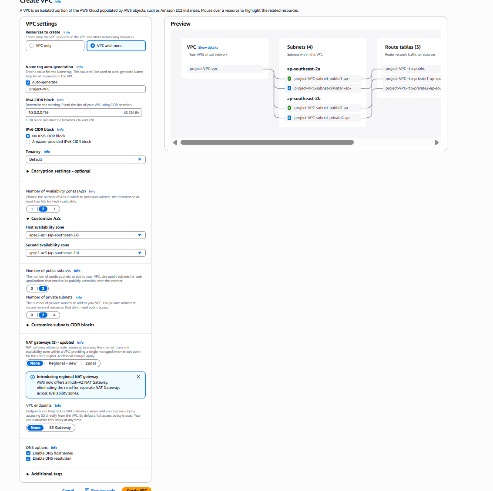
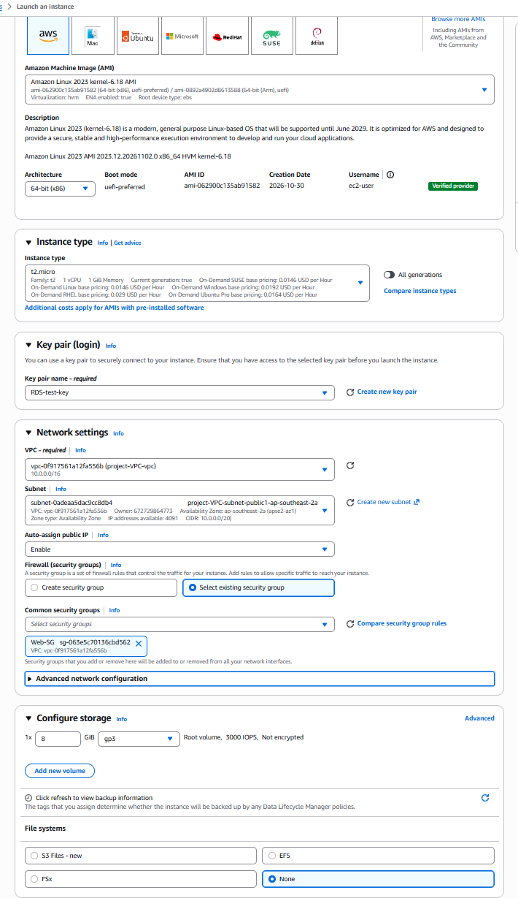
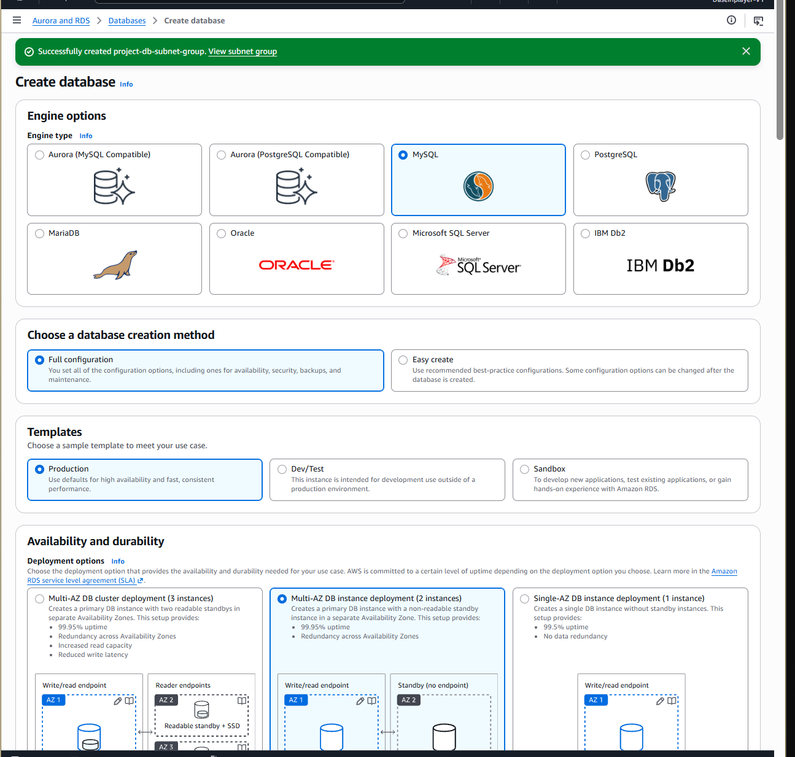
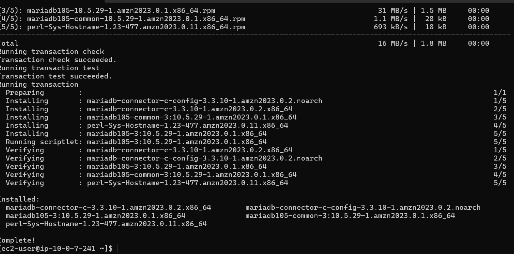
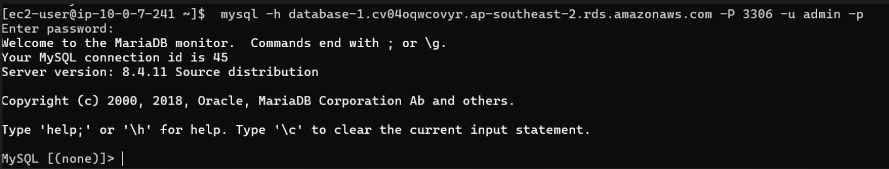
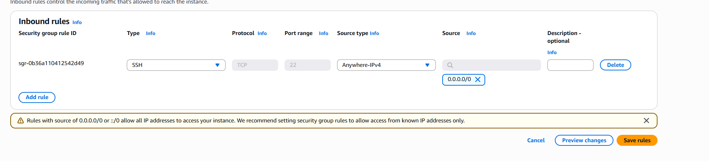

# AWS-2Tier-Architecture-Troubleshooting# AWS 2-Tier 安全架构部署与内网数据库连通性排障项目记录

## Summary
在现代公有云和混合云环境中，核心数据资产的网络隔离与访问控制是基础设施安全的重中之重。本报告记录了在 AWS 环境中从零构建符合最佳实践的双层隔离网络（2-Tier Architecture）的全过程。通过自定义 VPC 划分公有与私有子网，并配置严格安全组（Security Groups）的策略，实现了对 Amazon RDS 数据库的安全内网连接。

此外，项目记录了在实施过程中针对网络超时与跨平台密钥权限验证的故障排查，并在项目结束后展示了标准的云资源清理策略。

## Prerequisites and limitations
1. 一个处于激活状态的 AWS 账户（支持 Free Tier 免费套餐额度）。
2. 一对用于安全登录的非对称加密密钥（`.pem` 格式 Key pair）。
3. 具备基础网络访问权限的本地 Windows 操作系统环境及 CMD/PowerShell 终端。

## Architecture
本方案采用高可用性与高安全性的网络设计：
1. **自定义 VPC (Virtual Private Cloud)**：跨越 2 个可用区（Multi-AZ）实现高可用性。
2. **子网划分 (Subnets)**：部署 2 个公有子网（Public Subnets，通过 Internet Gateway 连通互联网）与 2 个私有子网（Private Subnets，无公网路由）。
3. **防火墙策略**：采用双层安全措施。前端由 Web-SG 安全组控制公网 SSH 流量入站；后端由 DB-SG 安全组控制，仅放行来自 Web-SG 的 3306 端口内网流量。



## Tools
- **Amazon VPC**：提供底层的网络隔离环境与路由控制。
- **Amazon EC2**：部署于公有子网，作为跳板机（Bastion Host）提供进入内网的加密计算节点。
- **Amazon RDS (MySQL)**：核心数据存储引擎，部署于私有子网，切断外部互联网的直接访问。
- **AWS Security Groups**：充当防火墙，执行入站与出站的流量过滤。

## Implementation Steps

### 1. VPC 与安全组配置
完成 VPC 创建及可用区分配后，配置默认路由表允许公有子网通过 IGW (Internet Gateway) 访问外部网络。配置安全组实现权限分离：
- 配置前端安全组限制 SSH (TCP 22) 访问源。
- 配置后端数据库安全组，仅允许带有前端安全组标记的实例通过 MySQL (TCP 3306) 端口进行访问。

### 2. 计算与数据资源的统筹部署
在公有子网启动 EC2 实例，并绑定用于登录的 `.pem` 密钥；在私有子网启动 Amazon RDS 实例，配置数据库管理员的用户名与密码，并明确将其分配至指定的内网安全组中。




### 3. OS 层环境初始化
通过 Windows 本地 CMD 控制台，使用 SSH 命令建立与 EC2 实例的加密隧道。登入 Amazon Linux 环境后，使用包管理器自动拉取并安装轻量级数据库客户端工具（MariaDB Client）。



### 4. 连通测试
利用 RDS 分配的内网 Endpoint、端口及凭证，从 EC2 发起内网数据库连接。



---

## Troubleshooting
在架构搭建与连通测试环节，主要排查并解决了以下两项连通性故障：

### Issue 1：EC2 实例 SSH 连接超时 (Connection Timed Out)
- **描述**：在本地尝试 SSH 连入公有子网 EC2 时，终端长时间无响应，最终抛出 `Connection timed out` 错误。
- **分析**：前端安全组的入站规则（Inbound Rule）出于安全考虑被设置为 `My IP`。但由于本地物理计算机的网络服务商提供的是动态公网 IP，IP 地址的突然变动导致 AWS 防火墙在网络层直接 Drop（丢弃）了合法的数据包。
- **解决**：作为排障定界手段，临时将该安全组的 SSH 入站规则源（Source）调整为 `Anywhere-IPv4 (0.0.0.0/0)`。确认网络链路打通后，再根据实际需求重新收紧访问策略。



### Issue 2：非对称加密密钥权限拒绝 (Bad Permissions)
- **描述**：网络层打通后，SSH 客户端主动拒绝连接，并抛出 `WARNING: UNPROTECTED PRIVATE KEY FILE!` 与 `Bad permissions` 的警告。

```text
Warning: Permanently added '13.211.130.148' (ED25519) to the list of known hosts.
@@@@@@@@@@@@@@@@@@@@@@@@@@@@@@@@@@@@@@@@@@@@@@@@@@@@@@@@@@@
@         WARNING: UNPROTECTED PRIVATE KEY FILE!          @
@@@@@@@@@@@@@@@@@@@@@@@@@@@@@@@@@@@@@@@@@@@@@@@@@@@@@@@@@@@
Permissions for 'RDS-test-key.pem' are too open.
It is required that your private key files are NOT accessible by others.
This private key will be ignored.
Load key "RDS-test-key.pem": bad permissions
```ec2-user@13.211.130.148: Permission denied (publickey,gssapi-keyex,gssapi-with-mic).

- **分析**：Windows NTFS 文件系统在下载 `.pem` 密钥文件时，默认使其继承了父目录的宽松权限。这使得当前账户之外的其他用户也可能拥有读取该私钥的权限。SSH 客户端的安全机制识别到此风险，主动阻断了连接。
- **解决**：查阅 AWS EC2 官方排障指南，决定重置 Windows 文件权限。在 CMD 中调用 `icacls` 权限管理命令：

  1. 剥夺该文件的所有继承权限：
     ```cmd
     icacls RDS-test-key.pem /inheritance:r
     ```
  2. 仅赋予当前活动用户（52433）的完全控制权（Full Control）：
     ```cmd
     icacls RDS-test-key.pem /grant 52433:F
     ```
  
  权限修复后再次执行 SSH 命令，成功绕过安全告警，顺利登入 EC2 环境。

---

## Cleanup / Cost Management
在完成架构连通性验证后，严格贯彻成本优化原则，立即切断计费服务：
1. **无快照删除 DB**：删除 RDS 实例，并在选项中拒绝最终快照（Snapshot）。
2. **终止 EC2**：在 EC2 控制台中将实例状态更改为 Terminate（终止）。
3. **释放弹性 IP**：进入 VPC/EC2 弹性公网 IP 面板，彻底释放因实例终止而处于未绑定状态的 Elastic IP (EIP)，成功阻断所有潜在的持续性闲置费用。
